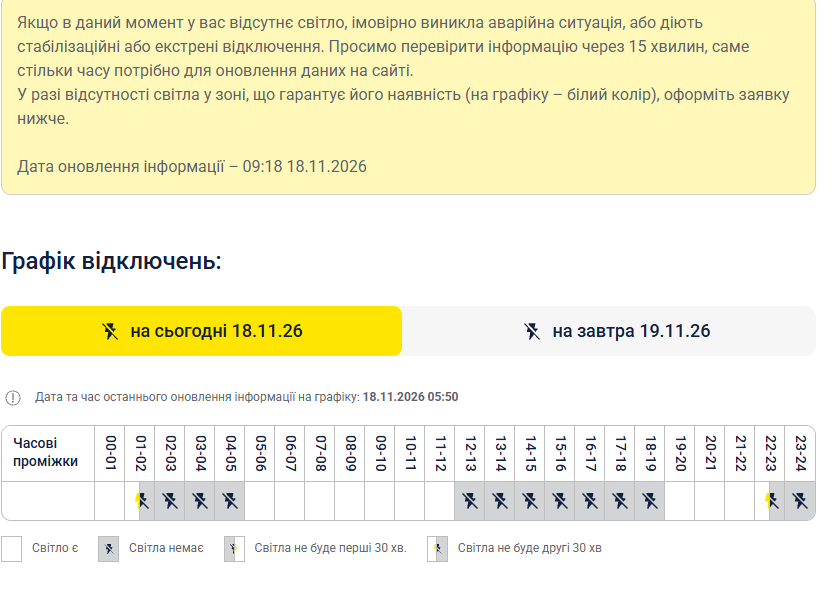
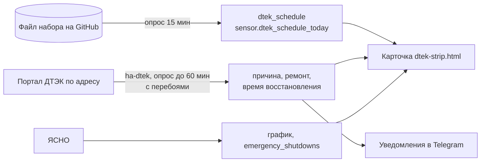
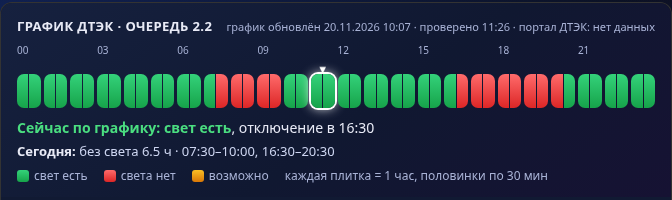

# ДТЭК: откуда брать данные об отключениях и как показать их в Home Assistant

Руководство для тех, кому нужно в Home Assistant знать **график отключений света** по очереди ДТЭК (Днепр, Кривой Рог и другие регионы ДТЭК), **когда свет пропал и когда включат** и **почему** (график, ремонт, авария), и показать это карточкой на дашборде. Всё здесь проверено на практике; готовые файлы лежат в каталоге [`dtek/`](dtek/).



*Эталон: страница ДТЭК с очередью 2.2. Серые плитки — «света нет», в 01–02 и 22–23 — «света не будет вторые 30 хв». Жёлтое поле сверху — сообщение сайта.*

## 1. Откуда брать данные

| Источник | Что даёт | Ограничения |
|---|---|---|
| **Файл набора на GitHub** [`Baskerville42/outage-data-ua`](https://github.com/Baskerville42/outage-data-ua) (`data/<регион>.json`) | График по очереди на сегодня (и завтра, когда опубликуют): по 24 часам, у каждого часа `yes / no / first / second / maybe / mfirst / msecond`; время обновления графика | Отстаёт от сайта примерно на 20 минут; **график на сайте меняют в любое время** (у нас сегодня: 05:30 и 07:52), поэтому опрашивать надо часто — каждые 15 минут |
| **[`ha-dtek`](https://github.com/aavdberg/ha-dtek)** (интеграция HACS) | **Идущее** отключение по вашему дому: время начала, **ожидаемое восстановление**, **причина** (`sub_type`), тип (плановые работы / авария), календарь | Читает портал ДТЭК, который закрыт защитой от ботов (Incapsula): данные приходят **с перебоями**. Будущих отключений не показывает (`next_outage` у нас за 9 дней ни разу не получил значения). Интервал опроса 5–60 минут |
| **ЯСНО**: [`ha-yasno-outages`](https://github.com/denysdovhan/ha-yasno-outages), [`ha-svitlo-yeah`](https://github.com/ALERTua/ha-svitlo-yeah) | График очереди, флаг аварийных отключений `emergency_shutdowns` | Может расходиться с ДТЭК по времени; для аварий данные ДТЭК надёжнее |
| **Сайт ДТЭК напрямую** (`…/ua/shutdowns`) | Таблица и жёлтое сообщение (ремонты, аварии) | **Недоступен серверным запросам:** даже настоящий headless-Chromium получает страницу блокировки «Request unsuccessful». Защиту не обходим и вам не советуем |
| Telegram-бот ДТЭК | Те же сообщения | Пишет в личный чат; читать его из HA можно только пользовательской сессией MTProto — тяжело и чувствительно |

**Рекомендуемое сочетание:** график берём из файла набора (компонент `dtek_schedule`), причину и время восстановления — из `ha-dtek`, как запасной график и признак аварийного режима — ЯСНО. **Правило приоритета: верен ДТЭК.** Если портал сообщил время восстановления — показываем его, иначе — график.



## 2. Какая у вас очередь

Очередь (`GPVx.y`) указана на странице отключений ДТЭК рядом с адресом («Черга 2.2» → `GPV2.2`) и в личном кабинете. Её нужно будет вписать в конфигурацию.

## 3. Компонент `dtek_schedule` (сенсор графика)

Каталог [`dtek/custom_components/dtek_schedule`](dtek/custom_components/dtek_schedule): забирает файл набора, находит вашу очередь и строит **48 получасовых ячеек** на сегодня (и на завтра, когда они есть).

Установка:

1. Скопируйте каталог в `<config>/custom_components/dtek_schedule`.
2. В `configuration.yaml` (пример — [`dtek/examples/configuration.yaml`](dtek/examples/configuration.yaml)):

```yaml
sensor:
  - platform: dtek_schedule
    group: "GPV2.2"        # ваша очередь
    interval_minutes: 15   # файл набора на GitHub, не сайт ДТЭК; минимум 15
```

3. Перезапустите Home Assistant. Первый запрос компонент делает через **10 минут после старта** (чтобы не бить в источники сразу).

Сенсор `sensor.dtek_schedule_today`:

| Атрибут | Что |
|---|---|
| `cells` | 48 значений на сегодня: `0` свет есть, `1` отключение, `2` возможно; ячейка = 30 минут с 00:00 |
| `date`, `group`, `updated` | дата графика, очередь, время обновления на стороне ДТЭК |
| `windows` | окна отключений, например `[{start: "01:30", end: "05:00"}, …]` |
| `tomorrow_cells`, `tomorrow_date` | то же на завтра, когда график опубликован |
| `status`, `source`, `fetched_at` | состояние источника и время последней загрузки |

Правило перевода часов набора в ячейки: `yes` → обе половины часа светлые, `no` → обе тёмные, `first` → отключена **первая** половина часа, `second` → **вторая**, `maybe/mfirst/msecond` → «возможно». Всё это покрыто тестами ([`dtek/tests`](dtek/tests), запуск: `cd dtek && python3 -m unittest discover -s tests`, 34 теста без Home Assistant).

Если файл набора не обновляется дольше 3 часов, компонент (редко, не чаще двух раз в сутки) пробует страницу сайта ДТЭК как запасной источник; при защите Incapsula он получает «challenge» и делает длинную паузу. Запасной источник можно отключить: `fallback_url: ""`.

## 4. Причина и ремонты: интеграция `ha-dtek`

Установите `ha-dtek` через HACS, добавьте интеграцию, выберите оператора (для Днепра `dtek-dnem`) и адрес. Она даст сущности `binary_sensor.dtek_…_outage_active`, `…_planned_maintenance_active`, `sensor.dtek_…_restore_time`, `…_outage_reason`, календарь. В id сущностей при входе через кабинет присутствует номер счёта (`dtek_account_<номер>_…`).

Важно знать:

- **Данные идут с перебоями**: при ответе Incapsula интеграция делает паузу 15 минут; сущности временами `unavailable`. Ставьте интервал **60 минут** (максимум) в опциях интеграции.
- **Перезапуск HA сбрасывает паузу и снова бьёт в портал.** Не перезапускайте HA без нужды.
- Причина в `outage_reason` бывает штатной («Стабілізаційне відключення (Згідно графіку погодинних відключень)») или нештатной («Аварійні ремонтні роботи» и т. п.) — нештатное стоит выделять.
- Будущие отключения портал не показывает — их берите из графика.

## 5. Карточка на дашборде

Готовые файлы: [`dtek/www/dtek-schedule.html`](dtek/www/dtek-schedule.html) (сама лента) и [`dtek/www/dtek-strip.html`](dtek/www/dtek-strip.html) (загрузчик). Пример карточки — [`dtek/examples/card.yaml`](dtek/examples/card.yaml).

1. Скопируйте оба файла в `<config>/www/`.
2. В `dtek-schedule.html` в начале скрипта замените `YASNO_STATUS_TODAY` / `YASNO_STATUS_TOMORROW` на свои сущности ЯСНО (если не используете ЯСНО — плашка аварийного режима просто не появится).
3. Добавьте карточку:

```yaml
type: iframe
url: /local/dtek-strip.html?v=1
aspect_ratio: 40%
```



*Так лента выглядит на дашборде (20.11.2026): отключения по графику 07:30–10:00 и 16:30–20:30, маркер «сейчас», пометка «портал ДТЭК: нет данных» — портал в этот момент не отвечал.*

Что показывает лента:

- 24 плитки по часу, у каждой две половинки по 30 минут (зелёная — свет, красная — отключение, жёлтая — возможно), подписи часов через 3 часа, маркер «▼ сейчас» с подсветкой текущего часа;
- строку «Сейчас по графику: свет есть, отключение в 12:00» и итог «Сегодня: без света 12.0 ч · 01:30–05:00, 12:00–19:00, 22:30–24:00»;
- график на завтра, когда он опубликован;
- плашки: «⚡ отключение идёт» с причиной и временем восстановления от `ha-dtek`, «🔧 плановые ремонтные работы», аварийный режим ЯСНО; если портал недоступен — только тихая пометка в заголовке.

Почему сделано именно так:

1. **Markdown-карточка не подходит:** Home Assistant вырезает у неё `style`, клетки не отрисовываются. Поэтому — отдельная страница в `iframe`.
2. Страница из того же origin читает данные прямо из родителя: `parent.document.querySelector('home-assistant').hass.states[...]`, поэтому токены и отдельные запросы к API не нужны.
3. **Кеш `/local/`:** Home Assistant отдаёт файлы из `www/` с `Cache-Control: max-age` в 31 день, и правки страницы не видны. Решение — загрузчик `dtek-strip.html`: он сам не меняется, а страницу ленты каждый раз подтягивает с `cache: "no-store"` и уникальным параметром. Для карточки всегда указывайте адрес загрузчика, а не `dtek-schedule.html`.
4. Для тёмных тем страница имеет собственную тёмную подложку и `color-scheme: dark` (без этого iframe в Chrome рисуется на белом фоне).
5. Анимации отключаются настройкой системы «уменьшить движение».

## 6. Уведомления в Telegram

Пример автоматизации по сущностям `ha-dtek` — [`dtek/examples/automation_telegram.yaml`](dtek/examples/automation_telegram.yaml): начало и конец отключения, плановые ремонтные работы, смена причины. Условие игнорирует переходы «недоступно ↔ значение», иначе каждая блокировка портала порождала бы сообщения.

## 7. «Скоро плановое отключение»

В [`dtek/examples/configuration.yaml`](dtek/examples/configuration.yaml) есть пример шаблона `binary_sensor.outage_soon`: он включается, когда по ячейкам графика в ближайшие 3 часа появляется отключение (учитывает только сегодняшний график). По нему удобно строить автоматизации вроде «зарядить батарею от сети заранее».

## 8. Подводные камни

1. Защита сайта и портала (Incapsula): не обходить, данные `ha-dtek` приходят с перебоями — не завязывайте критичную автоматику только на них.
2. Файл набора запаздывает на ~20 минут, поэтому для критичных решений используйте и время восстановления от `ha-dtek`.
3. График на сегодня меняют в течение дня: опрос реже 15 минут даёт устаревшую картину.
4. Часовой пояс: компонент и страница работают в `Europe/Kyiv`.
5. После правки `www/dtek-schedule.html` ничего перезапускать не нужно (загрузчик берёт свежую версию), но при правке самого `dtek-strip.html` браузер может держать старую копию — увеличьте `?v=` в адресе карточки.

## 9. Файлы

| Путь | Что |
|---|---|
| [`dtek/custom_components/dtek_schedule/`](dtek/custom_components/dtek_schedule) | компонент (сенсор графика) |
| [`dtek/tests/`](dtek/tests) | 34 теста + фикстуры (настоящие данные набора и страницы) |
| [`dtek/www/dtek-schedule.html`](dtek/www/dtek-schedule.html), [`dtek-strip.html`](dtek/www/dtek-strip.html) | лента графика и загрузчик без кеша |
| [`dtek/examples/`](dtek/examples) | конфигурация, карточка, автоматизация Telegram |
